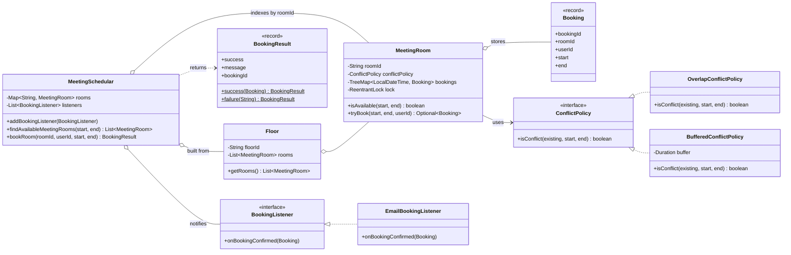

# Meeting Room Scheduler — LLD Guide

A low-level design for booking meeting rooms across floors, with pluggable conflict rules and booking notifications.

---

## 1. Problem Statement

Design a meeting room booking system for an office with several floors and rooms.

- Employees book a room for a time slot.
- A room can host only one meeting at a time.
- Anyone can search for rooms that are free in a given slot.
- When a booking is confirmed, interested parties (email, calendar, logs) must be notified.
- Some rooms need a buffer between meetings (for cleaning or setup).

### Requirements

| Type | Requirement |
|---|---|
| Functional | Book a room for `[start, end)` on behalf of a user |
| Functional | Find all rooms free for a given slot |
| Functional | Reject bookings that overlap, are invalid, or target an unknown room |
| Functional | Notify registered listeners after every confirmed booking |
| Functional | Support different conflict rules per room (e.g. buffer time) |
| Non-functional | Safe under concurrent booking requests for the same room |
| Non-functional | Easy to add new conflict rules and new listeners without changing existing code |

### Out of Scope (state these in the interview)

- Persistence and database
- Users, authentication, permissions
- Recurring meetings, cancellation, rescheduling (see extensions)
- Time zones (all times are `LocalDateTime` in one zone)

---

## 2. Clarifying Questions to Ask

1. **Slot semantics:** Is the end time exclusive? Can meeting B start exactly when meeting A ends? *(Assumed: yes, `[start, end)`.)*
2. **Buffers:** Do different rooms need different buffer rules? *(Assumed: yes, handled by a Strategy.)*
3. **Cancellation:** Is cancellation needed? *(Assumed: out of scope for v1, easy extension.)*
4. **Concurrency:** Can two users book the same room at the same instant? *(Assumed: yes; must not double-book.)*
5. **Notifications:** Are they synchronous or async? Must a failing listener stop the booking? *(Assumed: synchronous; a listener failure is swallowed so it cannot break a booking.)*
6. **Scale:** How many rooms and bookings per room? *(Assumed: tens of rooms, hundreds of bookings per room. Linear scan per room is acceptable.)*
7. **Search:** Only by time slot, or also by capacity, floor, or amenities? *(Assumed: time slot only in v1.)*

---

## 3. Use Cases

| Actor | Use case | Main flow |
|---|---|---|
| Employee | Book a room | Pick room + slot → system validates → room free → booking confirmed → listeners notified |
| Employee | Find free rooms | Pick slot → system returns rooms free for the whole slot |
| System | Notify | After each confirmed booking, call every registered `BookingListener` |

### Booking Flow

```
bookRoom(roomId, userId, start, end)
  ├─ room not found?          → failure("Meeting Room Not Found")
  ├─ start/end null or start ≥ end? → failure("Invalid meeting time slot")
  ├─ room.tryBook(...)         (checks conflict policy under the room's lock)
  │     ├─ conflict            → failure("Meeting Room is not available for the requested slot")
  │     └─ ok                  → Booking created and stored
  ├─ notify all listeners      (listener exceptions are ignored)
  └─ success(booking)
```

---

## 4. Class Design

### 4.1 Class Diagram



### 4.2 Responsibilities

| Class | Package | Responsibility |
|---|---|---|
| `MeetingSchedular` | `meetingroom` | Facade. Entry point for search and booking. Validates input, routes to a room, notifies listeners. |
| `Floor` | `model` | Groups rooms. Used only to build the scheduler's room index. |
| `MeetingRoom` | `model` | Owns the bookings of one room. Enforces "no conflicting bookings" under a lock. |
| `Booking` | `model` | Immutable record of a confirmed booking. |
| `BookingResult` | `model` | Immutable outcome of a booking attempt: success flag, message, booking id. |
| `ConflictPolicy` | `policy` | **Strategy.** Decides whether a requested slot clashes with an existing booking. |
| `OverlapConflictPolicy` | `policy` | Default rule. Overlap only; back-to-back meetings allowed. |
| `BufferedConflictPolicy` | `policy` | Rule with a buffer around each booking, e.g. 15 minutes for cleaning. |
| `BookingListener` | `listener` | **Observer.** Callback for confirmed bookings. |
| `EmailBookingListener` | `listener` | Example listener. Prints a confirmation. |

### 4.3 Package Layout

```
com.example.lld.meetingroom
├── MeetingSchedular.java        ← facade (entry point)
├── model/
│   ├── Booking.java
│   ├── BookingResult.java
│   ├── Floor.java
│   └── MeetingRoom.java
├── policy/
│   ├── ConflictPolicy.java      ← strategy interface
│   ├── OverlapConflictPolicy.java
│   └── BufferedConflictPolicy.java
└── listener/
    ├── BookingListener.java     ← observer interface
    └── EmailBookingListener.java
```

Tests live in `src/test/java/com/example/lld/meetingroom/MeetingSchedularTest.java`.

---

## 5. Design Patterns Used

| Pattern | Where | Why |
|---|---|---|
| **Strategy** | `ConflictPolicy` and its implementations, injected into `MeetingRoom` | Each room can have its own rule (overlap, buffer, future: max duration, working hours) without touching `MeetingRoom`. |
| **Observer** | `BookingListener`, registered on `MeetingSchedular` | Booking logic does not know about email, calendar, or logging. New listeners are added without changing the scheduler. |
| **Facade** | `MeetingSchedular` | Callers use one class for booking and search. They never touch rooms or policies directly. |
| **Factory Method (static)** | `BookingResult.success(...)` and `failure(...)` | Makes the two result shapes explicit and keeps the message text in one place. |
| **Immutable value objects** | `Booking`, `BookingResult` as Java records | Safe to share across threads and to pass to listeners. |

**Patterns considered and rejected**
- **Singleton** for the scheduler: hurts testing and gives no benefit here.
- **Builder** for `Booking`: only five fields; a constructor is enough.
- **Repository**: storage is in memory inside `MeetingRoom`. Extract it only when persistence is added.

---

## 6. Implementation Details

### 6.1 Conflict Detection

`MeetingRoom` stores bookings in a `TreeMap<LocalDateTime, Booking>` keyed by start time. A slot is available when no existing booking conflicts with it under the room's policy:

```java
boolean isAvailableInternal(LocalDateTime start, LocalDateTime end) {
    return bookings.values().stream()
            .noneMatch(existing -> conflictPolicy.isConflict(existing, start, end));
}
```

**Overlap rule** (`OverlapConflictPolicy`), half-open intervals `[start, end)`:

```
conflict  ⇔  existing.start < requested.end  AND  requested.start < existing.end
```

Back-to-back is safe: `09:00–10:00` and `10:00–11:00` do not conflict, because `10:00 < 10:00` is false.

**Buffer rule** (`BufferedConflictPolicy`): widen each existing booking by the buffer on both sides, then apply the overlap rule:

```
existing' = [existing.start − buffer, existing.end + buffer)
conflict  ⇔  existing'.start < requested.end  AND  requested.start < existing'.end
```

A booking that starts exactly `buffer` after the previous one ends is allowed.

### 6.2 Booking Flow and Concurrency

- `MeetingRoom.tryBook` takes the room's `ReentrantLock`, re-checks availability, and then inserts. The check and the insert happen under one lock, so two threads cannot both book the same slot.
- Locking is per room. Bookings in different rooms do not block each other.
- `MeetingSchedular.findAvailableMeetingRooms` checks each room with `isAvailable`, which takes that room's lock. The result is a snapshot. A room can be booked right after it is returned, which is normal for this kind of system.
- Listeners are stored in a `CopyOnWriteArrayList`. Registration is safe during reads and notifications.
- `notifyListeners` runs after the room lock is released. A slow listener does not block other bookings of that room, but it does delay the caller's return.
- A listener that throws a `RuntimeException` is caught and ignored, so one bad listener cannot break a confirmed booking.

### 6.3 Validation Order

1. Unknown room → `Meeting Room Not Found`
2. Null or `start ≥ end` → `Invalid meeting time slot`
3. Conflict → `Meeting Room is not available for the requested slot`
4. Otherwise success, then notify

Checking the room first means unknown rooms never reach the time logic.

### 6.4 Complexity

| Operation | Time | Notes |
|---|---|---|
| `bookRoom` | O(k) | k = bookings in that room. Scan calls the policy per booking. |
| `isAvailable` | O(k) | Same scan. |
| `findAvailableMeetingRooms` | O(R · k) | R = rooms. |
| `addBookingListener` | O(1) | |

With the overlap policy, a `TreeMap` lookup (`floorEntry` on `start`, `ceilingEntry` on `start`) could make this O(log k). It is kept as a linear scan because the scan works for any policy, and k is small here.

### 6.5 Known Limitations

- **Map key collision:** bookings are keyed by `start`. Two bookings with the same start cannot coexist. Both built-in policies already prevent this, but a custom policy that allows it would overwrite a booking. A list or a unique key would fix it.
- **No cancellation:** no method removes a booking.
- **Synchronous notification:** a slow listener delays the caller.
- **In-memory only:** a restart loses all bookings.

---

## 7. Edge Cases Covered by Tests

| Case | Expected | Test |
|---|---|---|
| Free slot | Success, listener called | `bookingFreeSlotSucceedsAndNotifiesListener` |
| Overlapping slot | Rejected, no notification | `overlappingBookingIsRejectedAndNotNotified` |
| Back-to-back slot | Allowed | `backToBackBookingIsAllowedUnderOverlapPolicy` |
| End before start | Rejected as invalid | `endBeforeStartIsRejected` |
| Unknown room | Rejected | `unknownRoomIsRejected` |
| Search excludes booked room | Booked room not returned | `availableRoomsExcludeRoomsThatAreBooked` |
| Inside buffer | Rejected | `bufferedPolicyRejectsBookingInsideBuffer` |
| Exactly at buffer edge | Allowed | `bufferedPolicyAllowsBookingExactlyAtBufferEdge` |
| Touching intervals in policy | No conflict | `overlapPolicyTreatsTouchingIntervalsAsNonConflicting` |

---

## 8. Extensions to Discuss

| Feature | Approach |
|---|---|
| Cancel booking | Add `cancelBooking(bookingId)` to `MeetingRoom`; remove from the map; add a `BookingCancelledListener` event. |
| Capacity and amenities search | Add `capacity` to `MeetingRoom`; filter in `findAvailableMeetingRooms` with a `RoomFilter` strategy. |
| Recurring meetings | Generate occurrences from a `RecurrenceRule` and book them atomically (all or none). |
| Working hours | New `ConflictPolicy` or a `BookingValidator` chain before `tryBook`. |
| Max booking duration | New validator, same as working hours. |
| Persistence | Extract a `BookingRepository` interface; `MeetingRoom` depends on it. |
| Async notifications | Replace the loop in `notifyListeners` with an `ExecutorService`. |
| Multi-room booking | Two-phase: check all rooms, then book all; roll back on failure. |

---

## 9. Interview Questions and Answers

**Q1. Why is the conflict rule a Strategy and not an `if` inside `MeetingRoom`?**
A. Rooms differ in their rules. A buffer rule today, working hours tomorrow. A Strategy lets a new rule be added as a new class, with no change to `MeetingRoom` (open/closed principle).

**Q2. Why are bookings stored per room instead of in one global list?**
A. Conflicts only matter within a room. Per-room storage keeps the scan small and lets each room have its own lock, so bookings in different rooms do not wait on each other.

**Q3. How do you prevent double booking under concurrency?**
A. The availability check and the insert happen together under the room's `ReentrantLock`. Without that, two threads could both see the slot as free and both book it (check-then-act race).

**Q4. Why is the lock per room and not global?**
A. A global lock would serialize every booking across the building. Per-room locks let unrelated rooms proceed in parallel.

**Q5. Why use half-open intervals `[start, end)`?**
A. It makes back-to-back meetings unambiguous. `10:00` ending and `10:00` starting do not overlap. Closed intervals would need special cases.

**Q6. Why is `Booking` a record?**
A. It is immutable, so it is safe to share with listeners and other threads, and it gets `equals`, `hashCode`, and `toString` for free.

**Q7. What happens if a listener throws?**
A. The exception is caught and ignored in `notifyListeners`. The booking is already confirmed, so a listener failure must not undo it. In production, you would log it.

**Q8. Why is the listener notified after the lock is released?**
A. Holding the room lock while calling external code (email, network) would block every other booking of that room for as long as the listener takes.

**Q9. How would you make search fast with many bookings?**
A. With the overlap policy, the `TreeMap` gives the nearest booking before and after the requested start. Two lookups answer "is this free?" in O(log k). The linear scan is kept only because it works for any policy.

**Q10. What if two bookings have the same start time?**
A. The `TreeMap` key would collide. Built-in policies never allow that, so it cannot happen today. This is listed as a known limitation. The fix is a list per start time, or a unique key.

**Q11. Why does `findAvailableMeetingRooms` return a snapshot?**
A. Rooms can change right after the check, so any answer is only true at that moment. The caller must still call `bookRoom` and handle failure.

**Q12. How would you add cancellation?**
A. Add `cancelBooking(bookingId)` to `MeetingRoom`, removing the booking under the lock. Then publish a cancellation event to listeners. Bookings need an index by id for fast lookup.

**Q13. Why did you not use a Singleton for `MeetingSchedular`?**
A. It is hard to test, hides dependencies, and nothing requires one instance. The scheduler is created with its floors, which is easy to set up per test.

**Q14. How would you add persistence?**
A. Put a `BookingRepository` behind `MeetingRoom`. Store bookings by room and time range, and use a database constraint or transaction for the no-overlap rule.

**Q15. What would you change for a real system?**
A. Persistence, a database-level no-overlap constraint, async notifications with retries, time zones, authentication, cancellation, and monitoring.

---

## 10. Running the Code and Tests

From the project root:

```bash
mvn test
```

Expected: `MeetingSchedularTest` runs 9 tests and all pass.

To try the scheduler in code, build the floors and rooms, create a `MeetingSchedular`, register a `BookingListener`, and call `bookRoom` or `findAvailableMeetingRooms`. See `MeetingSchedularTest.setUp()` for a working setup.
